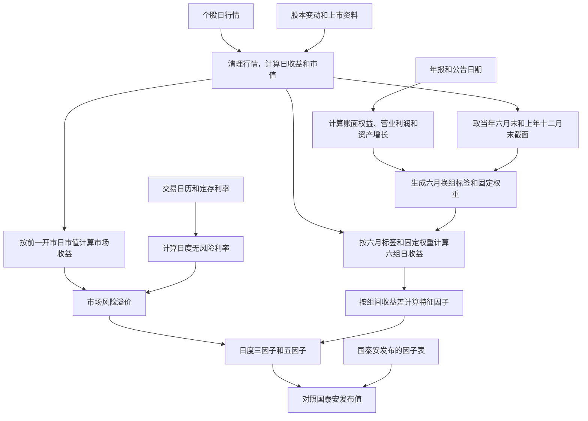

# 国泰安日度三因子和五因子计算流程

两版脚本使用同一套计算规则，复算沪深主板、创业板和科创板的日度三因子及五因子。每个模型都给出流通市值加权和总市值加权的结果。默认计算区间为 2000 年 1 月 1 日至 2026 年 8 月 19 日，实际输出日期以开市日历为准。较早的行情用于准备换组标签和年末市值等历史信息。

普通版生成 `日度三因子.csv`（日度三因子表）和 `日度五因子.csv`（日度五因子表），存放在项目的 `中间结果/02_变量构造结果/因子调整收益率/日度因子/`。探索版沿用同一套计算规则，把指定交易日的处理前后行列数、样例、换组标签、组合权重和收益展示在交互窗口。本文按探索版单元编号导航。

[普通版脚本](./复现国泰安日度三因子和五因子_普通版.py) · [探索版脚本](./复现国泰安日度三因子和五因子_探索版.py)

## 数据流转图



市场收益通常按前一开市日的市值加权。规模、价值、盈利和投资各组合使用六月换组时的固定市值加权。上年十二月末市值用于构造账面市值比。

## 1. 交易日历和无风险利率｜探索版第 01 单元

**代码片段**

```python
risk_free_rates = np.expm1(
    np.log1p(matched_rates['LumpFixed3Month'] / 100) / 365
).rename('rf')
```

**代码讲解**

交易日历选市场代码为 1 的开市记录，按日期去重、排序，并从完整日历取得六月和十二月最后一个开市日。对每个请求交易日，按日期往前找最近一次生效的三个月定期存款基准利率，允许同日生效。利率来源保留生效日期截至 2015 年 10 月 24 日的记录。若年利率在原表中以百分数 $a$ 表示，日利率为

$$
r_{f,t}=(1+a/100)^{1/365}-1.
$$

**本段生成或引入的变量**

`date`（交易日）、交易日序号和月末交易日由日历生成。`LumpFixed3Month`（三个月定存基准年利率）从利率表匹配，折算生成 `rf`（日度无风险利率）。

**表格结构变化**

原始日历按市场和日期记载。筛选后变为一行一个开市日。匹配利率按请求交易日补列，保留请求日期数。 [交易日历和无风险利率代码](./复现国泰安日度三因子和五因子_探索版.py#L245)

## 2. 年报合并与基础财务量｜探索版第 03 单元

**代码片段**

```python
previous_assets['year'] += 1
merged_financials = annual_balance.merge(
    previous_assets, on=financial_keys, how='left', validate='one_to_one'
)
```

**代码讲解**

保留报表期为 12 月 31 日的合并资产负债表、合并利润表和年报公告记录。以资产负债表为主表，按股票代码和财年一对一左连接上一年资产、当年利润表和公告日。上一年资产表的年份加一后再连接，使当年和上一年资产落在同一行。

- 账面权益 = 股东权益 + 递延所得税负债 − 递延所得税资产 − 优先股。后三项缺失按零处理。
- 营业利润 = 营业收入 − 营业成本 − 销售费用 − 管理费用。前两项须有值，两项费用缺失按零处理。
- 投资增长 = 本年总资产 ÷ 上年总资产 − 1。两年资产均须为正。

**本段生成或引入的变量**

`announced`（年报公告日）来自公告表。`book`（账面权益）、`operating_profit`（用于排序的营业利润分子）和 `inv`（投资增长）在本段生成。`blank_financial_profit`（利润科目全空且权益为正的标记）要求利润表记录存在，供后续按金融行业条件处理盈利能力。

**表格结构变化**

各源表先从股票 × 报表期及报表类型筛到股票 × 财年。筛选后的资产负债表确定行数，左连接主要增加列。 [年报筛选与财务变量代码](./复现国泰安日度三因子和五因子_探索版.py#L382)

## 3. 清理个股日行情｜探索版第 04、05 单元

**代码片段**

```python
daily_quotes = pd.merge_asof(open_day_quotes, share_flags, on='date', by='Stkcd')
daily_quotes['offer_return'] = daily_quotes['Dretwd'].where(
    ~listed_today, daily_quotes['Clsprc'].div(issue_price) - 1
)
```

**代码讲解**

行情从 1998 年起按原始下载分卷、分块读取，保留市场代码 1、4、16、32 对应的开市记录，并检查同一股票同日是否重复。按股票代码和日期向过去匹配最近生效的股本记录，按股票代码补充上市日期和发行价。有 B 股的公司优先取分别计价的总市值，缺失时回退到原总市值。流通市值等于原流通市值加上调整后总市值超过基准总市值的正差额。上市当天发行价为正时，日收益改用收盘价除以发行价再减一。

行情清理阶段保留停牌填充行。它们可能提供前一开市日的市场权重，也用于识别需要回填的年末市值。日收益汇总时再按填充标记筛选。行业参考表按适用的历史分类标准整理，后续按股票和日期向过去匹配金融行业标记。

**本段生成或引入的变量**

- `Stkcd`（股票代码）、`Filling`（填充标记）、`Dretwd`（原始日收益率）和 `Clsprc`（收盘价）来自行情。
- `has_b_shares`（是否有 B 股）、`cross_listed`（是否跨市场上市）来自股本资料。
- `daily_total_cap`（调整后总市值）、`daily_float_cap`（调整后流通市值）和 `offer_return`（上市首日按需修正后的日收益率）在这里生成。

**表格结构变化**

市场和日历筛选减少行情行数。股本匹配和市值计算补充列，结果仍是一行一个股票交易日，键为股票代码和交易日。 [股本、行业和上市资料](./复现国泰安日度三因子和五因子_探索版.py#L559) · [分年行情清理代码](./复现国泰安日度三因子和五因子_探索版.py#L748)

## 4. 六月换组和特征标签｜探索版第 05、07 单元

**代码片段**

```python
formation_labels = june_weights.join(
    december_features[list(feature_columns)], how='inner'
).reset_index()
```

**代码讲解**

1. **六月规模组。** 当年六月末流通市值为正的股票进入规模截面。以主板流通市值中位数为断点，达到中位数归大盘，低于中位数归小盘。六月流通市值和总市值同时留下，作为接下来一轮的固定加权权重。
2. **上年末估值。** 三因子使用上年最后一个交易日的调整后流通市值。五因子对满足条件的跨市场上市股票，优先用截至六月换组时已披露的 12 月 31 日流通股数乘年末收盘价，并统一市值单位。两者遇到年末填充且有可用历史成交市值时，都改用截至上年末最近一笔非填充行情的流通市值。
3. **上年财务特征。** 只采用公告日不晚于六月换组日的上年年报。账面市值比要求账面权益和相应年末市值为正。盈利能力等于营业利润除以账面权益。2023 年换组前要求权益非零，并把上年末识别为金融行业的公司的盈利特征置为缺失。自 2023 年换组起要求权益为正，符合利润科目全空条件的金融股以零作为盈利排序值。
4. **交叉分组。** 对三因子账面市值比、五因子账面市值比、盈利能力和投资增长分别取主板第 30、70 百分位断点。达到高断点归高组，低于低断点归低组，其余有效值归中组。中小板并入深市主板前，从断点样本排除对应代码段，满足其余条件的股票仍可入组。六月规模表和上年末特征表按股票代码取交集。

每轮标签用于当年 7 月至次年 6 月。上半年沿用上年六月的标签，下半年切到当年六月标签。

**本段生成或引入的变量**

- `size_group`（规模组）、`float_cap`（六月流通市值权重）和 `total_cap`（六月总市值权重）由六月截面生成。
- `value_cap3`（三因子年末估值分母）和 `value_cap5`（五因子年末估值分母）用于计算账面市值比。
- `bm3`（三因子账面市值比）、`bm5`（五因子账面市值比）、`op`（盈利能力）、`inv`（投资增长）在排序前是数值。写入换组标签表时，相同列名代表对应特征的低、中、高组。

**表格结构变化**

日行情取出六月末和上年十二月末，各形成一张股票截面。上年末截面左接财务变量，随后和六月截面内连接。结果每轮换组每只股票一行。某项特征缺失时，相应标签为空。 [六月规模、年末特征和标签](./复现国泰安日度三因子和五因子_探索版.py#L968) · [标签生效期](./复现国泰安日度三因子和五因子_探索版.py#L1735)

## 5. 市场风险溢价｜探索版第 06、07 单元

**代码片段**

```python
market_quotes[weight_column] = current_cap.shift().where(
    previous_day_exists, current_cap
)
```

**代码讲解**

把上年十二月末行情接到当年行情上。同一股票的两条相邻记录在市场交易日序号上相差 1 时，用前一开市日市值作权重，其中可以含停牌填充市值。没有相邻记录时，用当日市值。然后选请求日期中 `Filling=0`（非填充）的记录，用修正后的日收益率加权。缺失收益、缺失权重及非正权重不参与加权。市场组合使用通过这些条件的沪深个股，无需匹配六月换组标签。逐日市场风险溢价为

$$
\text{市场风险溢价}_t
=\frac{\sum_i w_{i,t}R_{i,t}}{\sum_i w_{i,t}}-r_{f,t}.
$$

**本段生成或引入的变量**

`lag_float`（市场组合的流通市值权重）、`lag_total`（市场组合的总市值权重）为临时变量。`Market1`（流通市值加权市场收益）、`Market2`（总市值加权市场收益）减去 `rf`（日度无风险利率）后，生成两列 `RiskPremium`（市场风险溢价）。

**表格结构变化**

股票 × 交易日按交易日加权汇总。输出跟随请求交易日历，一天一行，分别列出两种权重的市场收益和市场风险溢价。 [市场权重与收益汇总代码](./复现国泰安日度三因子和五因子_探索版.py#L1285)

## 6. 六组日收益和特征因子｜探索版第 06、07、09 单元

**代码片段**

```python
labeled_quotes = daily_quotes.loc[valid_quotes].merge(
    formation_labels, on='Stkcd', how='inner', validate='many_to_one'
)
group_returns, valid_weights = weighted_mean_by_group(
    feature_quotes, ['date', 'size_group', feature_column],
    'offer_return', weight_column, 'portfolio_return',
)
```

**代码讲解**

先保留非填充且原始日收益有值的个股日记录，再按股票代码接上当期六月标签。2023 年 7 月 1 日前，日度行业识别为金融股的记录移出盈利能力组合。对四项排序特征分别处理，只在该项标签有值、计算用收益有值且对应六月权重为正时计入组合。每项特征把小盘、大盘和低、中、高交叉成六组。每组按六月固定市值加权，分母由当天实际参与该组的股票决定。

下表为**虚构示例**，数值只用来说明计算。同一天，两只有效股票落在同一个小盘高特征组，按同一市值口径加权。

| 股票 | 六月固定市值（示例单位） | 当日收益率 |
| ---- | -----------------------: | ---------: |
| 甲   |                      100 |         2% |
| 乙   |                      300 |       −1% |

该组股票数为 2，权重合计为 400，组合收益为 $[100\times 2\%+300\times(-1\%)]/400=-0.25\%$。当天若乙的计算用收益缺失，乙也从权重分母中移出，股票数为 1，权重合计为 100，组合收益为 2%。

每种特征、每种权重都单独计算两类组间收益差。以下下标分别表示规模和特征分组。

$$
\begin{aligned}
\text{规模差}
&=\frac{R_{\text{小低}}+R_{\text{小中}}+R_{\text{小高}}}{3}
-\frac{R_{\text{大低}}+R_{\text{大中}}+R_{\text{大高}}}{3},\\
\text{高低差}
&=\frac{R_{\text{小高}}+R_{\text{大高}}}{2}
-\frac{R_{\text{小低}}+R_{\text{大低}}}{2}.
\end{aligned}
$$

| 模型   | 因子             | 从组合收益到因子                                             |
| ------ | ---------------- | ------------------------------------------------------------ |
| 三因子 | 规模、价值       | 三因子账面市值比排序的规模差、高低差                         |
| 五因子 | 规模             | 五因子账面市值比、盈利能力和投资增长排序所得三个规模差的均值 |
| 五因子 | 价值、盈利、投资 | 依次取五因子账面市值比高减低、盈利高减低、投资低减高         |

公式所需的组合收益缺失时，相应收益差保留缺失。例如中组缺失影响规模差，高低差仍可用完整的高、低两端计算。五因子的规模因子要求三个规模差都有效。

**本段生成或引入的变量**

`portfolio_return`（组合日收益）、`n_stocks`（参与加权的股票数）和 `sum_weight`（参与股票的六月市值合计）由当日有效组员生成。权重合计保留市值单位，组内权重占比可用单只股票权重除以该组权重合计得到。

**表格结构变化**

股票日表接入标签后仍是一行一个股票日。按交易日、规模组和特征组汇总成组合日表。每项特征、每种权重分别由组合收益计算出按交易日排列的特征因子。 [有效权重与六组公式](./复现国泰安日度三因子和五因子_探索版.py#L1204) · [个股进入组合及因子汇总](./复现国泰安日度三因子和五因子_探索版.py#L1397)

## 7. 合成日度结果与国泰安对照｜探索版第 02、08、10 单元

**代码片段**

```python
year_factor_table = year_market.join(
    year_feature_factors, validate='one_to_one'
).rename_axis('date').reset_index()
```

**代码讲解**

市场表按交易日一对一左接特征因子，再拼接各年结果。日期覆盖检查要求每个请求交易日至少有一条非填充、原始收益有值的行情。部分组合在该日缺失时，相应因子仍可为空。

国泰安发布表筛到市场代码 `P9714`（沪深指定市场），五因子另保留组合方式代码 1。发布值按交易日左接复算结果，仅用于计算误差。差值为复算值减发布值，乘以 10,000 转成基点。区间表报告有效配对交易日数、相关系数、均方根误差、平均绝对误差和有符号平均偏差。

**本段生成或引入的变量**

`results[3]`（复算三因子日表）和 `results[5]`（复算五因子日表）在探索版内存中可查看。`factor_comparison_tables`（逐日因子配对表）和 `comparisons`（分区间误差汇总）由复算值和发布值配对后生成。

**表格结构变化**

每个模型正式输出一张交易日表，三因子 8 列、五因子 12 列，均含交易日和日利率。逐日对照在同一行补充发布值和误差。区间汇总每行对应一个模型、一个因子和一种权重。 [分年结果合并](./复现国泰安日度三因子和五因子_探索版.py#L1810) · [逐日与区间对照](./复现国泰安日度三因子和五因子_探索版.py#L1954) · [正式文件列定义](./复现国泰安日度三因子和五因子_普通版.py#L528)

## 探索版从哪里看

在第 00 单元设置 `preview_date`（预览交易日）和可选的 `preview_stock_code`（追踪股票代码）。日期留空时取所选区间的最后一个交易日。第 05、06 单元定义函数，对应的行情、换组和加权步骤在第 07 单元调用时展示。

| 想核对的问题                                                 | 查看位置                                         |
| ------------------------------------------------------------ | ------------------------------------------------ |
| 股票有没有通过市场筛选？市值、收益有没有调整？               | 第 07 单元的分年行情和股本匹配输出               |
| 用的是哪一年的六月标签？股票在规模和四项特征里分别属于哪组？ | 第 07 单元打印的换组年度、主板断点和最终标签     |
| 该股实际参与了哪些组合？每组有几只股票、多少权重？           | 第 09 单元的组合预览与指定股票明细               |
| 这一天最终算出多少？和官方差多少？                           | 第 08 单元的指定日最终值、第 10 单元的发布值对照 |

第 09 单元的 `group_preview_table`（指定日组合预览表）按两种权重、四项特征、两种规模和三种特征组补齐 48 个组合格。空组的股票数与权重合计显示为零，组合收益保持缺失。指定股票有六月标签但当日未参与加权时，可从股票明细核对其原分组。 [预览配置](./复现国泰安日度三因子和五因子_探索版.py#L40) · [指定日组合预览](./复现国泰安日度三因子和五因子_探索版.py#L1871)

## 总体表结构流转

| 阶段             | 一行是什么                                     | 行数怎样变化                                           |
| ---------------- | ---------------------------------------------- | ------------------------------------------------------ |
| 交易日历和日利率 | 一个交易日                                     | 筛选开市日后按请求区间取日期，利率匹配增加列           |
| 合并后的财务表   | 一只股票的一个财年                             | 年报筛选减少原始记录，左连接保留资产负债表行数         |
| 清理后行情       | 一只股票的一个交易日                           | 市场与日历筛选减少行数，股本及上市资料补充列           |
| 六月换组标签     | 一轮换组的一只股票                             | 取六月与上年末截面交集，保留规模组、两个权重及四项标签 |
| 特征组合日表     | 一个交易日、一个权重口径、一个特征下的一组股票 | 有效股票日汇总为各组收益、组内股票数和权重和           |
| 正式因子表       | 一个交易日                                     | 同日拼接市场和特征因子，跨年份沿行拼接                 |
| 发布值误差汇总   | 一个区间内的一个模型、因子与权重组合           | 按日期配对后对每列因子做区间统计                       |

## 最终样本重要变量组

因子列名后缀 `1`（流通市值加权）、`2`（总市值加权）。收益和利率以小数存储，例如 0.01 表示 1%。

| 正式输出列                         | 含义                                 | 所在文件       |
| ---------------------------------- | ------------------------------------ | -------------- |
| `date`（交易日）                 | 每张表的唯一键                       | 三因子、五因子 |
| `rf`（无风险利率）               | 当日折算后的无风险利率               | 三因子、五因子 |
| `RiskPremium1/2`（市场风险溢价） | 各权重口径的市场收益减日度无风险利率 | 三因子、五因子 |
| `SMB1/2`（规模因子）             | 小盘减大盘，按各模型的组合口径计算   | 三因子、五因子 |
| `HML1/2`（价值因子）             | 各模型的高账面市值比组合减低组       | 三因子、五因子 |
| `RMW1/2`（盈利因子）             | 高盈利能力组合减低组                 | 五因子         |
| `CMA1/2`（投资因子）             | 低资产增长组合减高组                 | 五因子         |

## 两版对照时最容易混淆的地方

- **正式列与预览列。** 探索版内存结果还留着市场组合收益供核对，正式文件只选择交易日、无风险利率和因子列。对照两版时按交易日对齐这组正式列。
- **入组与当日参与。** 六月标签决定该股票归哪组。某天实际参与加权还要看行情填充标记、原收益和计算用收益、特征标签及对应权重。因此各组每日股票数和权重合计可以变动。
- **当前复算样本。** 两版从国泰安原始行情、财报等资料构造因子样本。项目另有基础清洗后的个股日度样本索引，本流程的筛选依据是上面列出的国泰安复算条件。
